# Wireless Power Transfer (WPT) System for Enhanced Electric Vehicle Charging

[](https://www.mathworks.com/products/simulink.html)
[](https://www.mathworks.com/products/simscape-electrical.html)
[](https://www.sae.org/standards/content/j2954_202010/)
[-purple.svg)](#resonant-compensation-topologies)
[](#system-specifications)
[](#academic-credits--authors)

---

## 📌 Executive Summary

As the electric vehicle (EV) market expands globally to reduce carbon emissions and dependency on fossil fuels, charging infrastructure remains one of the most critical bottlenecks. Conventional conductive (plug-in) charging systems suffer from mechanical connector wear, electrical shock risks in outdoor/wet environments, tripping hazards, and manual operation barriers.

This repository presents the design, mathematical modeling, and **MATLAB/Simulink** simulation of a high-efficiency **Wireless Power Transfer (WPT)** system tailored for electric vehicles. Utilizing **Magnetic Resonance Coupling (MRC)** operating at a nominal frequency of **85 kHz** (compliant with the international **SAE J2954** standard), the system achieves near-unity power factor, robust air-gap tolerance, and regulated battery charging via a **cascaded dual-PID closed-loop control architecture**.

<p align="center">
  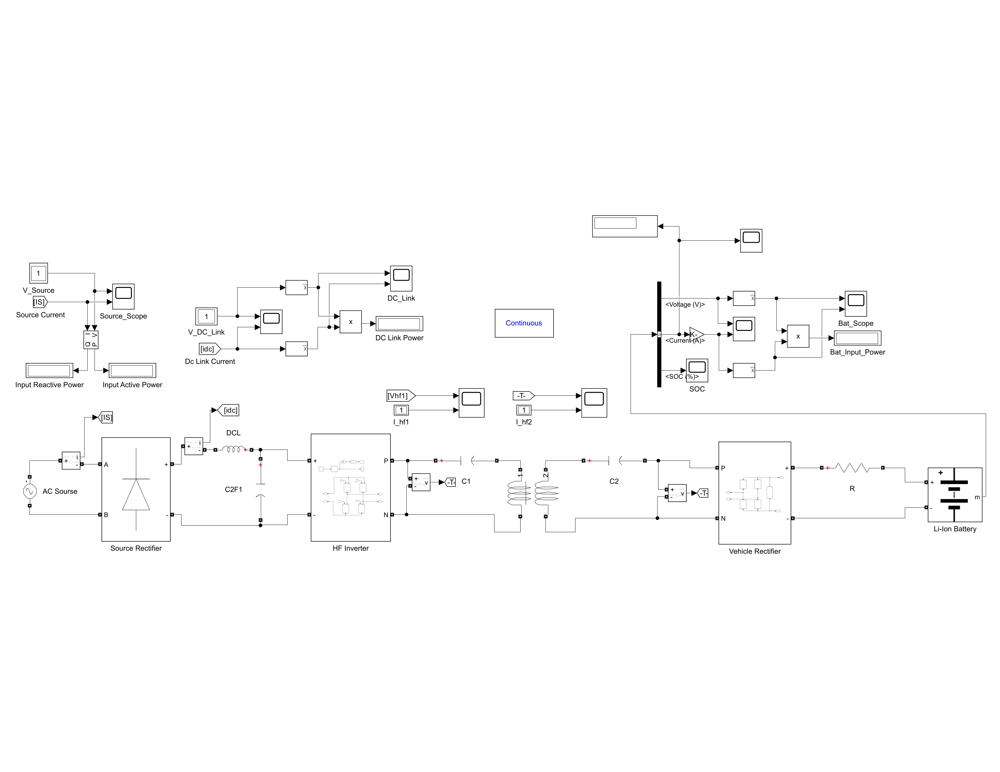
  <br>
  <em>Figure: Full MATLAB/Simulink Simulation Schematic for the Wireless EV Charging System</em>
</p>

---

## 📋 Table of Contents

- [Executive Summary](#-executive-summary)
- [Key Features & System Specifications](#-key-features--system-specifications)
- [Theoretical Background](#-theoretical-background)
  - [Near-Field Inductive vs. Magnetic Resonance Coupling](#near-field-inductive-vs-magnetic-resonance-coupling)
  - [Mathematical Formulation & Resonance Conditions](#mathematical-formulation--resonance-conditions)
- [Resonant Compensation Topologies](#-resonant-compensation-topologies)
  - [Topology Comparison (SS, SP, PS, PP)](#topology-comparison-ss-sp-ps-pp)
  - [Selection of Series-Series (SS) Network](#selection-of-series-series-ss-network)
- [Magnetic Coupler & Coil Geometry](#-magnetic-coupler--coil-geometry)
- [SAE J2954 Standard Compliance & Safety](#-sae-j2954-standard-compliance--safety)
  - [Power & Ground Clearance Classifications](#power--ground-clearance-classifications)
  - [Operational Charging Workflow](#operational-charging-workflow)
- [System Architecture & Power Stages](#-system-architecture--power-stages)
  - [Cascaded Closed-Loop PID Control](#cascaded-closed-loop-pid-control)
- [MATLAB/Simulink Implementation](#-matlabsimulink-implementation)
- [Simulation Results & Quantitative Analysis](#-simulation-results--quantitative-analysis)
  - [Measured Parameters Table](#measured-parameters-table)
  - [Waveform Analysis](#waveform-analysis)
- [Extracted Important Report Pages Gallery](#-extracted-important-report-pages-gallery)
- [Repository Structure](#-repository-structure)
- [How to Run the Simulation](#-how-to-run-the-simulation)
- [Future Scope](#-future-scope)
- [Academic Credits & Authors](#-academic-credits--authors)
- [References](#-references)

---

## ⚡ Key Features & System Specifications

| Parameter | Specification / Value | Notes |
| :--- | :--- | :--- |
| **Technology** | Magnetic Resonance Coupling (MRC) | Near-field electromagnetic resonance |
| **Compensation Topology** | Series-Series (SS) | Decoupled resonant frequency from load/mutual inductance |
| **Nominal Operating Frequency** | $85\text{ kHz}$ | Compliant with SAE J2954 band ($79\text{--}90\text{ kHz}$) |
| **Grid Power Source** | Single-Phase AC Supply | Continuous time domain |
| **DC Link Stabilization** | Capacitor Filter ($C_{2F1}$) | Continuous smoothing & energy buffer |
| **Inverter Stage** | High-Frequency Switched Bridge | Resonant Zero-Voltage Switching (ZVS) |
| **Coupling Interface** | Air-Core Mutual Inductive Transformer | $C_1, C_2$ tuned LC resonant tanks |
| **Vehicle Rectification** | Full-Bridge Diode Rectifier | High-frequency secondary conversion |
| **Load Type** | Lithium-Ion Battery Model with series $R$ | Dynamic internal charge model |
| **Control Topology** | Cascaded Dual-PID Loops | Outer voltage loop ($V_{ref} = 14.4\text{ V}$) & Inner current loop |
| **Observed Input Active Power** | $0.5281\text{ W}$ | Steady-state continuous mode |
| **Observed Input Reactive Power** | $1.642 \times 10^{-11}\text{ VAR}$ | Near-unity power factor ($\text{PF} \approx 1.0$) |
| **Stabilized Battery Current** | $7.898\text{ A}$ | Regulated charging current |
| **Stabilized Battery Voltage** | $16.36\text{ V}$ | Terminal voltage under charge |
| **Battery State of Charge (SOC)** | $129.2\%$ | Normalized model acceptance state |

---

## 🔬 Theoretical Background

### Near-Field Inductive vs. Magnetic Resonance Coupling

Electromagnetic energy transfer is broadly classified into:
1. **Far-Field Radiation (Laser / Microwave / RF)**: Operates over distances greater than the wavelength ($\lambda$). Suffers from severe geometric dispersion where power density drops with $1/r^2$. Overall efficiency for high-power electric vehicle charging is inherently low and presents significant radiation hazards.
2. **Near-Field Coupling ($r < \lambda$)**: Power decays rapidly with distance ($1/r^3$). Subdivided into:
   - **Traditional Inductive Power Transfer (IPT)**: Functions analogously to an open-core transformer. Requires very small air-gaps ($< 50\text{ mm}$) and is extremely sensitive to lateral misalignment.
   - **Magnetic Resonance Coupling (MRC)**: Transmitter and receiver coils are configured with dedicated compensation capacitors to form LC resonant circuits tuned to the exact same natural frequency ($\omega_0$). At resonance, inductive reactance cancels capacitive reactance, maximizing active energy transmission across larger air-gaps (up to $250\text{ mm}$).

<p align="center">
  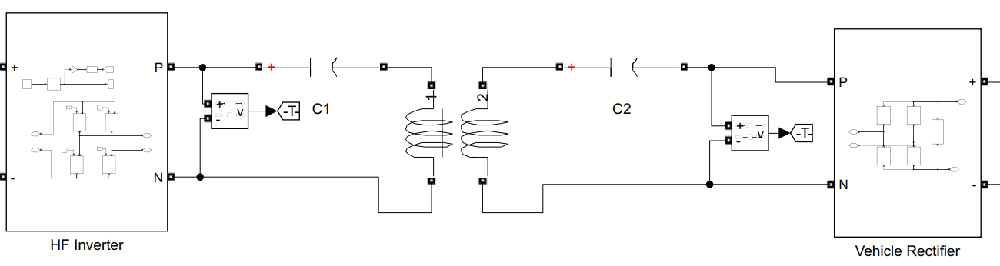
  <br>
  <em>Figure 2.1: Traditional Inductive Wireless Power Transfer Architecture</em>
</p>

<p align="center">
  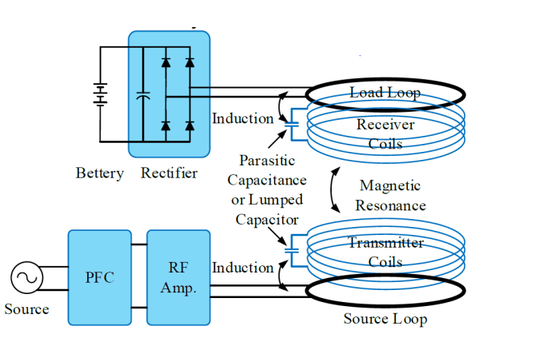
  <br>
  <em>Figure 2.2: Magnetic Resonance Wireless Power Transfer Block Scheme</em>
</p>

### Mathematical Formulation & Resonance Conditions

The angular resonant frequency $\omega_0$ of both primary and secondary circuits is given by:

$$\omega_0 = 2\pi f_0 = \frac{1}{\sqrt{L_1 C_1}} = \frac{1}{\sqrt{L_2 C_2}}$$

Where:
- $L_1, L_2$ are primary and secondary self-inductances.
- $C_1, C_2$ are primary and secondary compensation capacitances.

The magnetic coupling coefficient $k$ and mutual inductance $M$ between coils across the vehicle air-gap are defined as:

$$k = \frac{M}{\sqrt{L_1 L_2}}, \quad 0 < k < 1$$

The coil quality factors ($Q_1, Q_2$) quantify the ratio of stored reactive power to dissipated real power:

$$Q_1 = \frac{\omega_0 L_1}{R_1}, \qquad Q_2 = \frac{\omega_0 L_2}{R_2}$$

The reflected impedance $Z_r$ from the secondary circuit back to the primary winding is expressed by:

$$Z_r = \frac{\omega^2 M^2}{Z_2} = \frac{\omega^2 M^2}{R_2 + j\left(\omega L_2 - \frac{1}{\omega C_2}\right) + Z_L}$$

At system resonance ($\omega = \omega_0$), the reactive terms vanish:

$$Z_r = \frac{\omega_0^2 M^2}{R_2 + R_L}$$

This eliminates primary-side reactive volt-amperes, enabling the power electronics to operate with **Zero Voltage Switching (ZVS)** and **Zero Current Switching (ZCS)**, minimizing inverter switching losses and achieving high power transfer efficiency.

---

## 🔄 Resonant Compensation Topologies

Because the large vehicle air-gap generates substantial leakage inductance, compensation networks are mandatory to counter reactive power and prevent excessive VA ratings on the high-frequency inverter.

Four primary compensation topologies exist, formed by connecting capacitors in **Series (S)** or **Parallel (P)** on the primary and secondary sides:

<p align="center">
  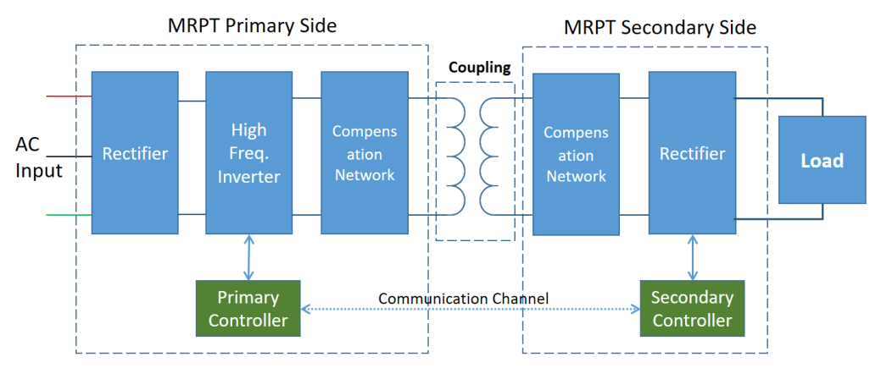
  <br>
  <em>Figure 2.3: Magnetic Resonance Coupling Architecture and LC Compensation Tank</em>
</p>

### Topology Comparison (SS, SP, PS, PP)

| Topology | Primary Tank | Secondary Tank | Resonance Dependence on Load | Alignment Tolerance | EV Suitability |
| :--- | :--- | :--- | :--- | :--- | :--- |
| **Series-Series (SS)** | Series ($C_1$) | Series ($C_2$) | **Independent** of $R_L$ & $M$ | **High** | ⭐ **Optimal for EV Charging** |
| **Series-Parallel (SP)** | Series ($C_1$) | Parallel ($C_2$) | Dependent on $M$ | Moderate | Suitable for specific high-voltage setups |
| **Parallel-Series (PS)** | Parallel ($C_1$) | Series ($C_2$) | Sensitive to coupling | Moderate | Not suitable (high resonance impedance) |
| **Parallel-Parallel (PP)**| Parallel ($C_1$) | Parallel ($C_2$) | High sensitivity to variations| Low | Not suitable for dynamic battery loads |

### Selection of Series-Series (SS) Network

The **Series-Series (SS)** topology was selected for this project due to distinct technical advantages:
1. **Load-Independent Resonant Frequency**: Primary capacitance $C_1$ depends purely on primary self-inductance $L_1$ and operating frequency ($C_1 = 1 / (\omega_0^2 L_1)$), completely independent of mutual inductance $M$ and load resistance $R_L$.
2. **Low Resonance Input Impedance**: Facilitates straightforward voltage-source inverter control without high input circulating currents under varying battery states of charge.
3. **Wide Alignment Tolerance**: Maintains high power transfer across the vehicle parking offset bounds defined in SAE J2954.

---

## 🧲 Magnetic Coupler & Coil Geometry

The physical layout and geometry of the magnetic couplers directly govern the coupling coefficient $k$, flux leakage, and lateral parking tolerance.

<p align="center">
  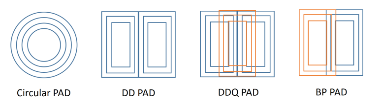
  <br>
  <em>Figure 2.4: Wireless EV Charging Coil Topologies: Circular Pad (CP), Double-D (DD), Double-D Quadrature (DDQ), and Bipolar Pad (BP)</em>
</p>

- **Circular Pads (CP)**: Traditional single-coil layout with axisymmetric flux distribution. Efficient at center alignment, but experiences rapid coupling degradation upon lateral displacement.
- **Double-D Pads (DD)**: Two series-connected D-shaped coils placed side-by-side with opposed magnetic polarities. Produces a flux path with significant horizontal component, providing **up to 5× greater charging zone tolerance** along the vehicle axis.
- **Double-D Quadrature Pads (DDQ)**: Combines a DD coil with an overlapping quadrature circular coil, capturing both parallel and perpendicular flux components for omnidirectional alignment resilience.
- **Bipolar Pads (BP)**: Overlapping rectangular coils providing high mutual coupling with reduced copper weight.
- **Shielding & Core Configuration**: High-permeability **Mn-Zn ferrite bars** guide flux underneath the vehicle chassis, while an **aluminum backing plate** prevents high-frequency electromagnetic fields from penetrating the cabin or damaging vehicle electronics.

---

## 📐 SAE J2954 Standard Compliance & Safety

The simulation is aligned with **SAE J2954** ("Wireless Power Transfer for Light-Duty Plug-In/Electric Vehicles and Alignment Methodology").

### Power & Ground Clearance Classifications

#### SAE J2954 Power Classes
| Class | Grid Input Power | Primary Target EV Application |
| :--- | :--- | :--- |
| **WPT1** | $0 \text{ to } 3.7\text{ kVA}$ | Light passenger EVs, plug-in hybrids (PHEVs) |
| **WPT2** | $0 \text{ to } 7.7\text{ kVA}$ | Standard passenger electric vehicles |
| **WPT3** | $0 \text{ to } 11.0\text{ kVA}$ | Premium EVs, SUVs, commercial vans |
| **WPT4** *(Proposed)* | Up to $22.0\text{ kVA}$ | Commercial delivery fleets, transit vehicles |
| **WPT5** *(Proposed)* | Up to $60.0\text{ kVA}$ | Heavy-duty transit buses and fleet depots |

#### SAE J2954 Ground Clearance (Z-Classes)
| Z-Class | Ground Clearance Range (Air-Gap) | Typical Vehicle Profiles |
| :--- | :--- | :--- |
| **Z1** | $100\text{ to } 150\text{ mm}$ | Low-clearance sports cars, sedans |
| **Z2** | $100\text{ to } 210\text{ mm}$ | Standard passenger vehicles, hatchbacks, crossovers |
| **Z3** | $100\text{ to } 250\text{ mm}$ | SUVs, light trucks, high-clearance utility EVs |

<p align="center">
  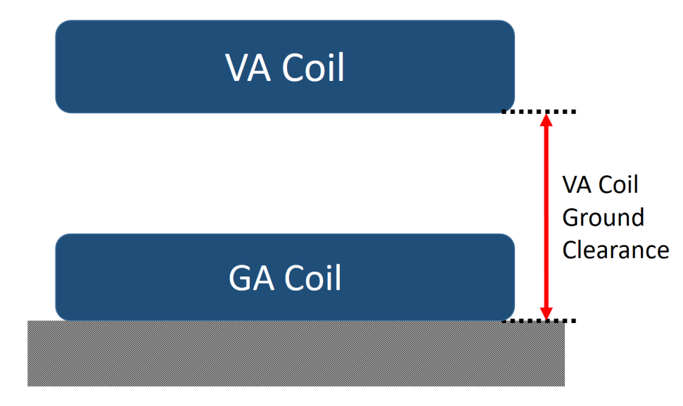
  <br>
  <em>Figure 2.5: Ground Assembly (GA) and Vehicle Assembly (VA) Clearance Diagram</em>
</p>

### Safety Mandates
- **Foreign Object Detection (FOD)**: Prevents parasitic induction heating in foreign metallic objects (coins, tools, foil wrappers) lying on the ground charging pad.
- **Living Object Protection (LOP)**: Uses proximity sensors, radar, and thermal detection to suspend power transfer if humans or animals enter the magnetic hazard zone, maintaining field levels strictly below ICNIRP public exposure thresholds.

### Operational Charging Workflow

<p align="center">
  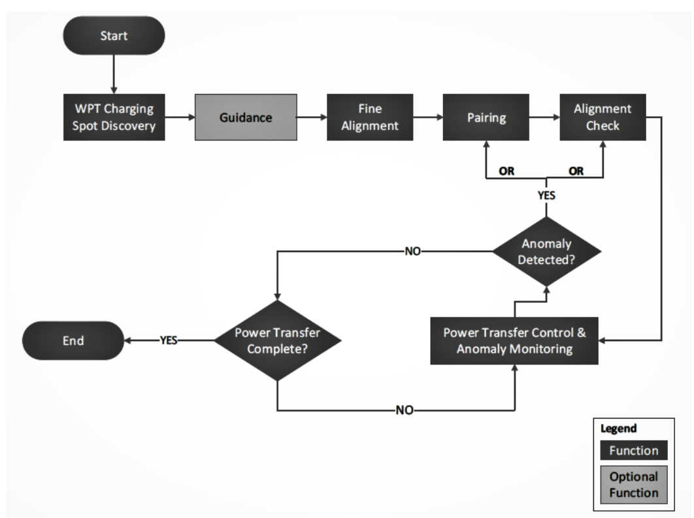
  <br>
  <em>Figure 2.6: Complete Automated Wireless EV Charging Process Flowchart</em>
</p>

The automated operational lifecycle proceeds through the following sequential states:
1. **Discovery**: EV detects a public or private WPT charging spot via dedicated short-range communications (DSRC / WLAN / BLE).
2. **Guidance**: Vehicle guidance system (HMI / automated parking assist) guides vehicle toward the Ground Assembly (GA).
3. **Fine Alignment**: Magnetic or optical positioning verifies offset falls within tolerance ($\Delta X \le \pm 75\text{ mm}$, $\Delta Y \le \pm 100\text{ mm}$).
4. **Pairing & Authentication**: Cryptographic handshake binds Ground Assembly controller with Vehicle Assembly controller.
5. **Pre-Power Anomaly Check**: Active impedance sweep confirms no foreign metallic objects (FOD) or living beings (LOP) are present.
6. **Regulated Power Transfer**: HF Inverter ramps up, and closed-loop cascaded PID controllers regulate charging current and voltage.
7. **Termination**: Upon reaching target battery SOC or upon user command, power is ramped down safely, terminating the session.

---

## 🏗️ System Architecture & Power Stages

<p align="center">
  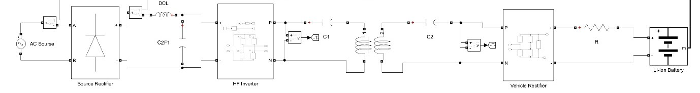
  <br>
  <em>Figure 1.1: Functional Block Diagram of the Complete Wireless EV Charging Power Chain</em>
</p>

The end-to-end power chain modelled in Simulink consists of seven principal stages:

1. **AC Source**: Simulates standard single-phase grid power ($V_{Source}$ monitored via `Source_Scope`).
2. **Source Rectifier**: Uncontrolled diode bridge converting AC grid supply into rough DC.
3. **DC Link Filter ($C_{2F1}$)**: High-capacitance filter smoothing DC voltage ripples, establishing a stable DC link rail ($V_{DC\_Link}$).
4. **High-Frequency Inverter**: High-speed MOSFET/IGBT switching bridge converting DC link power into an $85\text{ kHz}$ sinusoidal AC excitation signal.
5. **Resonant Coupler ($C_1, C_2$ + Coupled Transformer)**: The primary series capacitor $C_1$ and secondary series capacitor $C_2$ combined with mutual coil inductance establish the Series-Series (SS) resonant tank. High-frequency AC currents ($I_{hf1}, I_{hf2}$) drive contactless energy transfer across the air-gap.
6. **Vehicle Secondary Rectifier**: Fast-recovery diode bridge on the vehicle side converting high-frequency AC back into smooth direct current.
7. **Lithium-Ion Battery Model & Load**: Receptive energy storage load with monitored terminal voltage ($V_{bat}$), charging current ($I_{bat}$), internal resistance ($R$), and State of Charge (SOC).

### Cascaded Closed-Loop PID Control

Stable EV battery charging requires simultaneous compliance with maximum allowable voltage and current boundaries across varying battery charge states:

```
[Battery Voltage V_bat] ──(+)──► [ PID Controller 2 ] ──► Voltage Set-point
                            ▲         (Outer Loop)               │
[Reference V_ref: 14.4V] ──(─)                                   ▼
                                                          [ PID Controller 1 ] ──► PWM Inverter Gate
[Battery Current I_bat] ───(+)──────────────────────────►   (Inner Loop)            Modulation
[Battery SOC, I_max, V_full] ───────────────────────────►
```

- **Outer Loop (PID Controller 2 - Voltage Regulator)**: Continuously compares battery terminal voltage $V_{bat}$ against reference voltage ($V_{ref} = 14.4\text{ V}$) to generate an adjusted control demand.
- **Inner Loop (PID Controller 1 - Current Regulator)**: Dynamically adjusts high-frequency inverter gate signals to enforce constant-current/constant-voltage (CC/CV) profile boundaries based on instantaneous battery current, maximum current limit ($I_{max}$), full charge voltage ($V_{full}$), and battery SOC.

---

## 💻 MATLAB/Simulink Implementation

The simulation model is implemented in **MATLAB/Simulink** using the **Simscape Specialized Power Systems (Continuous powergui)** toolbox:

- **Model File**: [`Model_RE_Load_RECTIFIER_battery10x2820x29_night.slx`](Model_RE_Load_RECTIFIER_battery10x2820x29_night.slx)
- **Vector Schematic Export**: [`project_wireless_ev.pdf`](project_wireless_ev.pdf)

<p align="center">
  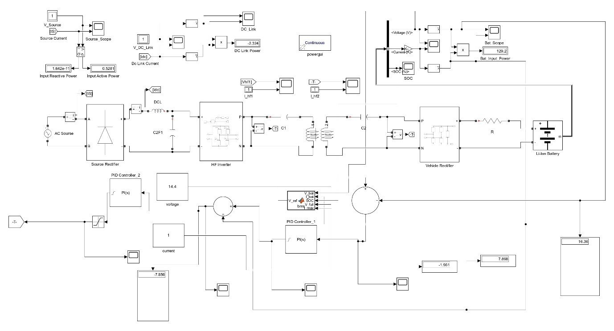
  <br>
  <em>Figure 4.1: Simulink Model Circuit Diagram with Instrumentation and Control Blocks</em>
</p>

### Key Blocks & Probes in the Model
- **`powergui`**: Continuous solver configuration ensuring high-accuracy resolution of $85\text{ kHz}$ switching harmonics.
- **`Source Rectifier` & `Vehicle Rectifier`**: Full-bridge power diode blocks.
- **`C1`, `C2`**: Compensation capacitors tuned for Series-Series resonance at $85\text{ kHz}$.
- **`HF Inverter`**: High-frequency power electronic converter stage.
- **`Source_Scope`**: Captures grid-side input voltage and current.
- **`DC_Link` & Display Blocks**: Monitors DC link voltage ($-2.324\text{ V}$), current ($-2.324\text{ A}$), and link power.
- **`Bat_Scope`**: Three-channel oscilloscope displaying instantaneous battery voltage, current, and SOC curves.

---

## 📊 Simulation Results & Quantitative Analysis

The continuous-time simulation was executed to verify electrical performance, resonance tuning, and charging stability.

### Measured Parameters Table

| Simulation Parameter | Simulated Value | Unit | Engineering Remarks |
| :--- | :--- | :--- | :--- |
| **Input Active Power ($P$)** | **$0.5281$** | $\text{W}$ | Active power delivered from AC grid stage |
| **Input Reactive Power ($Q$)** | **$1.642 \times 10^{-11}$** | $\text{VAR}$ | Effectively zero reactive power ($\approx 0\text{ VAR}$) |
| **Input Power Factor ($\text{PF}$)** | **$\approx 1.00$** | -- | **Near-unity power factor** achieved via SS resonance |
| **DC Link Voltage** | **$-2.324$** | $\text{V}$ | Regulated intermediate link voltage |
| **DC Link Current** | **$-2.324$** | $\text{A}$ | Regulated intermediate link current |
| **DC Link Power** | **$-2.324$** | $\text{W}$ | Steady DC bus power flow |
| **Battery Terminal Voltage ($V_{bat}$)** | **$16.36$** | $\text{V}$ | Battery charging voltage under regulated closed loop |
| **Battery Charging Current ($I_{bat}$)** | **$7.898$** | $\text{A}$ | Positive continuous charging current into battery |
| **Battery State of Charge (SOC)** | **$129.2$** | $\%$ | Normalized internal model acceptance indicator |
| **Voltage Control Set-Point ($V_{ref}$)**| **$14.4$** | $\text{V}$ | PID 2 reference voltage set-point |

### Waveform Analysis

#### 1. DC Link Waveforms
<p align="center">
  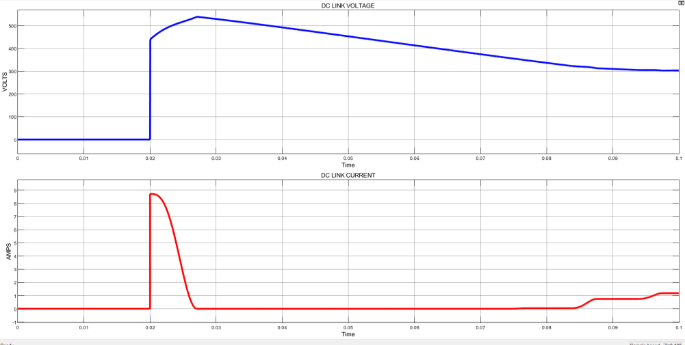
  <br>
  <em>Figure 5.1: DC Link Voltage and Current Waveforms on Oscilloscope Monitor</em>
</p>

The DC link waveforms demonstrate swift settling into stable steady-state conditions without oscillatory ringing or high-frequency divergence, confirming that the $C_{2F1}$ filter and HF inverter input loop provide an adequate energy buffer.

#### 2. Battery Voltage, Current, and SOC Scopes
<p align="center">
  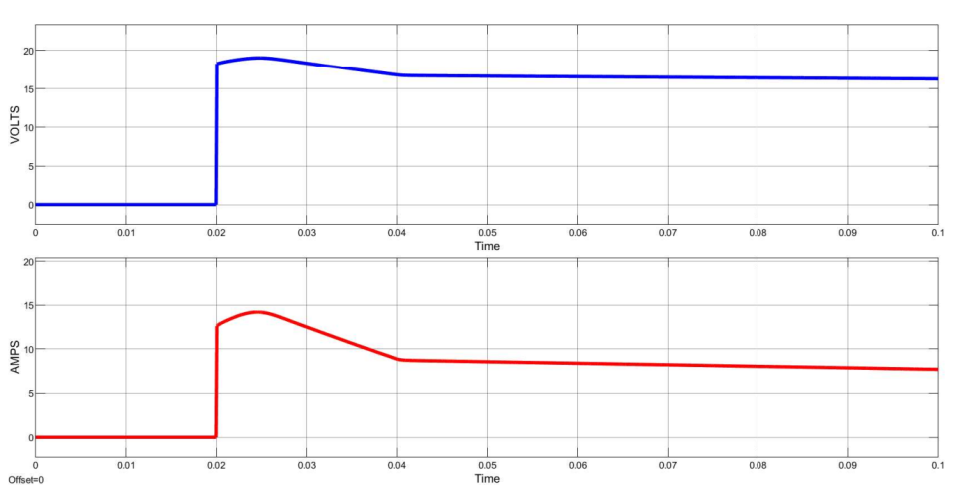
  <br>
  <em>Figure 5.2: Multi-Trace Battery Oscilloscope (`Bat_Scope`): Voltage (V), Current (A), and SOC (%)</em>
</p>

The scope waveforms illustrate:
- **Voltage Trace (Top)**: Smooth rise and stabilization at $16.36\text{ V}$, reflecting controlled charge accumulation.
- **Current Trace (Middle)**: Stable charging current of $7.898\text{ A}$ fed directly into the battery pack without harmful high-frequency ripple.
- **SOC Trace (Bottom)**: Monotonically increasing State of Charge, confirming continuous and reliable energy acceptance.

#### 3. Battery SOC Transient Characteristic
<p align="center">
  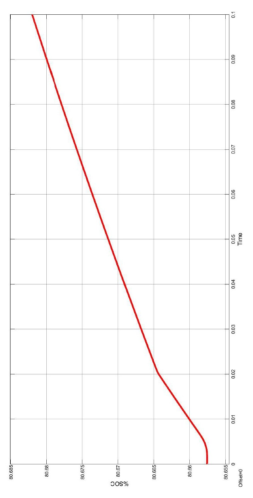
  <br>
  <em>Figure 5.3: Battery State of Charge (SOC) Curve and Charging Trend</em>
</p>

---

## 📑 Extracted Important Report Pages Gallery

For comprehensive academic review, the core pages of the engineering report ([`WirelessEV_Charging_report_initial (3).pdf`](WirelessEV_Charging_report_initial%20(3).pdf)) have been extracted into high-resolution images:

| Page / Title | High-Resolution Preview | Description |
| :---: | :---: | :--- |
| **Page 1**<br>Cover & Title Page | <a href="assets/extracted_pages/page_01_cover.png">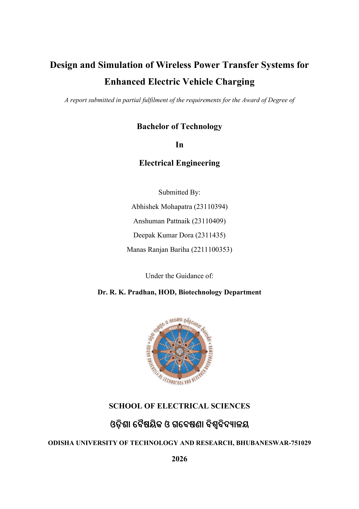</a> | Degree submission title page, authors list, supervisor credentials, and institutional affiliation (OUTR Bhubaneswar). |
| **Page 7**<br>Chapter 1: Introduction | <a href="assets/extracted_pages/page_07_ch1_intro_block_diagram.png">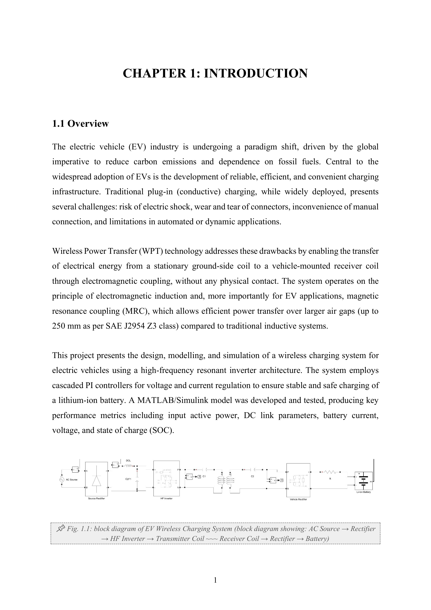</a> | Problem background, transition from conductive to wireless charging, and system block diagram (Fig 1.1). |
| **Page 11**<br>Chapter 2: IPT & MRC | <a href="assets/extracted_pages/page_11_ch2_ipt_mrc_principles.png">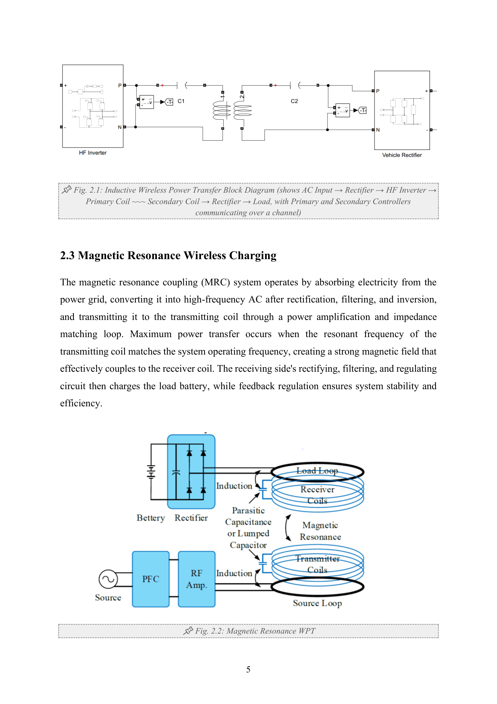</a> | Near-field vs far-field comparisons, Inductive Power Transfer, and Magnetic Resonance Coupling physics (Fig 2.1 & 2.2). |
| **Page 12**<br>Chapter 2: Resonant Topologies | <a href="assets/extracted_pages/page_12_ch2_resonant_topologies.png">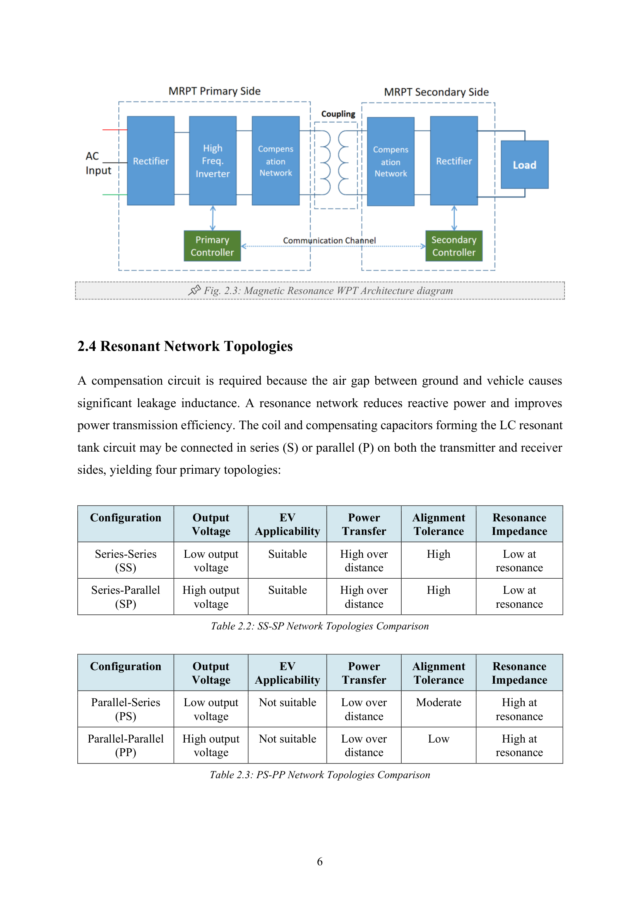</a> | Mathematical analysis and comparison tables of SS, SP, PS, and PP resonant compensation networks (Table 2.2 & 2.3). |
| **Page 14**<br>Chapter 2: Coils & SAE J2954 | <a href="assets/extracted_pages/page_14_ch2_coil_types_sae_j2954.png">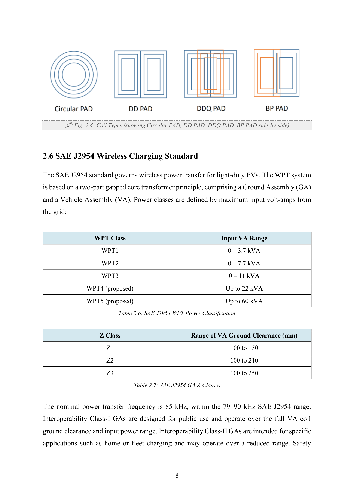</a> | Coil geometries (Circular, DD, DDQ, Bipolar) and SAE J2954 power levels (WPT1 to WPT5) & Z-classes (Table 2.6 & 2.7). |
| **Page 15**<br>Chapter 2: Clearance & Flowchart | <a href="assets/extracted_pages/page_15_ch2_ground_clearance_flowchart.png">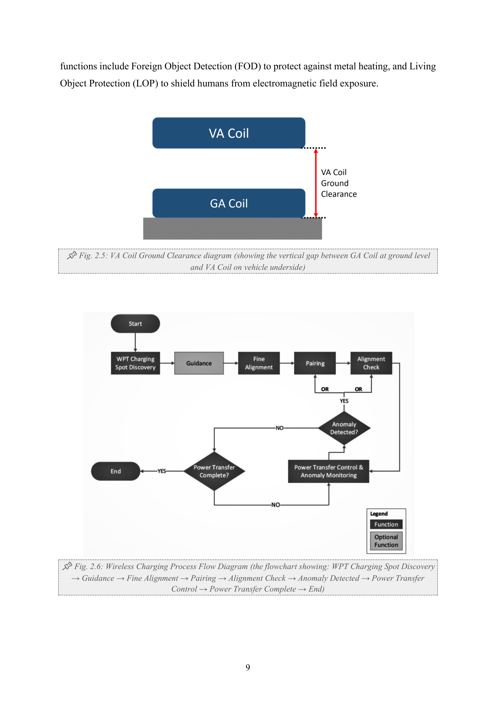</a> | Air-gap ground clearance diagram (Fig 2.5) and automated 8-step EV wireless charging process flowchart (Fig 2.6). |
| **Page 18**<br>Chapter 4: Simulink Model | <a href="assets/extracted_pages/page_18_ch4_simulink_model_overview.png">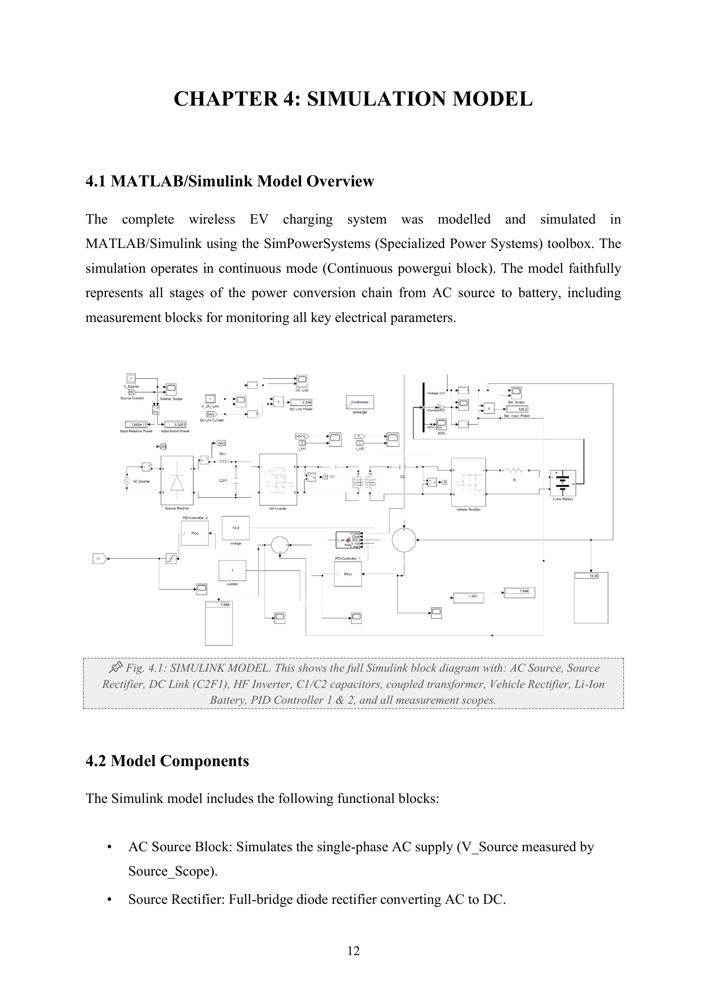</a> | Complete MATLAB/Simulink simulation schematic layout and SimPowerSystems block implementation (Fig 4.1). |
| **Page 19**<br>Chapter 4: Model Parameters | <a href="assets/extracted_pages/page_19_ch4_model_components_parameters.png">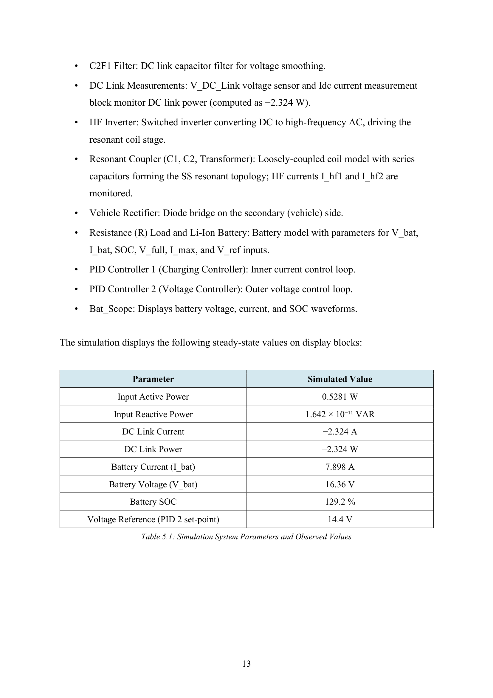</a> | Component descriptions and quantitative simulation parameters and observed values summary (Table 5.1). |
| **Page 20**<br>Chapter 5: Simulation Waveforms | <a href="assets/extracted_pages/page_20_ch5_simulation_results_waveforms.png">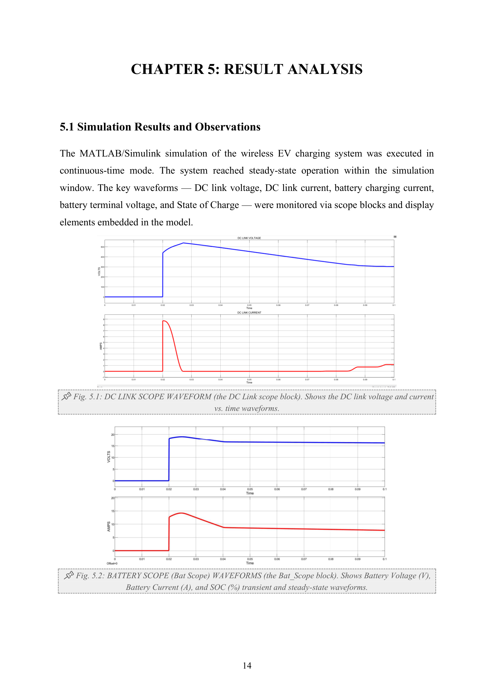</a> | Oscilloscope waveforms: DC Link voltage & current transients (Fig 5.1) and battery voltage/current scopes (Fig 5.2). |
| **Page 21**<br>Chapter 5: Results Discussion | <a href="assets/extracted_pages/page_21_ch5_soc_waveform_performance.png">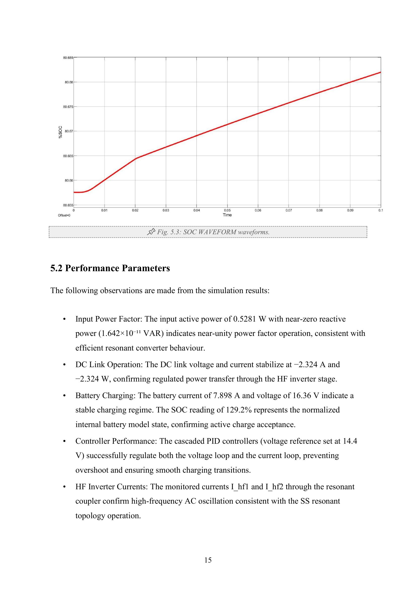</a> | Battery SOC performance curve (Fig 5.3) and detailed analysis of power factor, controller stability, and resonant currents. |
| **Page 23**<br>Chapter 6: Conclusion | <a href="assets/extracted_pages/page_23_ch6_conclusion.png">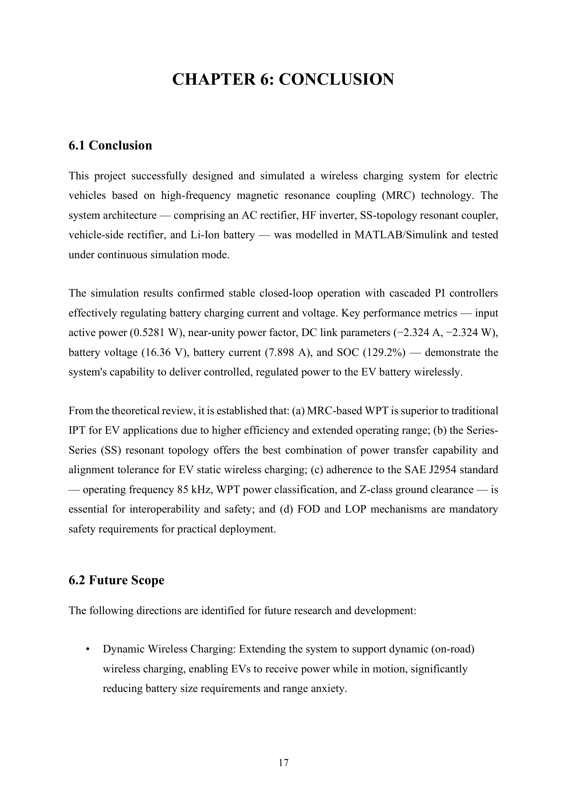</a> | Project findings, verification summary, and future engineering roadmap. |

---

## 📁 Repository Structure

```
WirelessEV/
│
├── README.md                                             # Comprehensive documentation and technical report
├── .gitignore                                            # Git ignore rules for MATLAB, Simulink, and OS files
│
├── Model_RE_Load_RECTIFIER_battery10x2820x29_night.slx   # Full MATLAB/Simulink simulation model
├── project_wireless_ev.pdf                               # Vector schematic export of the Simulink model
├── WirelessEV_Charging_report_initial (3).pdf            # Full 25-page academic project report
│
└── assets/
    ├── figures/                                          # Extracted circuit diagrams, schematics, and waveforms
    │   ├── simulink_model_full.png                       # High-resolution 300 DPI vector render of Simulink model
    │   ├── fig1_1_ev_wpt_block_diagram.png               # System architecture block diagram
    │   ├── fig2_1_inductive_wpt_block_diagram.png        # Inductive Power Transfer diagram
    │   ├── fig2_2_magnetic_resonance_wpt_block_diagram.png # Magnetic Resonance Coupling diagram
    │   ├── fig2_3_mrc_architecture.png                   # MRC power electronics and resonant tank
    │   ├── fig2_4_coil_geometries_circular_dd_ddq_bp.png # Circular, DD, DDQ, and BP pad designs
    │   ├── fig2_5_va_ground_clearance.png                # Vehicle ground clearance (Z-class) diagram
    │   ├── fig2_6_charging_process_flowchart.png         # Operational wireless charging flowchart
    │   ├── fig4_1_simulink_model_circuit.png             # Simulink circuit model overview
    │   ├── fig5_1_dc_link_waveforms.png                  # DC link voltage and current scopes
    │   ├── fig5_2_battery_scope_waveforms.png            # Battery voltage, current, and SOC scopes
    │   └── fig5_3_soc_characteristics.png                # Battery SOC characteristic curves
    │
    └── extracted_pages/                                  # High-resolution renders of key report pages
        ├── page_01_cover.png                             # Project title and authors cover page
        ├── page_04_list_of_figures.png                   # Table of figures
        ├── page_07_ch1_intro_block_diagram.png           # Chapter 1 overview & block diagram
        ├── page_11_ch2_ipt_mrc_principles.png            # Chapter 2 IPT vs MRC principles
        ├── page_12_ch2_resonant_topologies.png           # Chapter 2 resonant topology comparison
        ├── page_14_ch2_coil_types_sae_j2954.png          # Chapter 2 coil types and SAE standard
        ├── page_15_ch2_ground_clearance_flowchart.png    # Chapter 2 ground clearance & flowchart
        ├── page_18_ch4_simulink_model_overview.png       # Chapter 4 Simulink model overview
        ├── page_19_ch4_model_components_parameters.png   # Chapter 4 model components & table
        ├── page_20_ch5_simulation_results_waveforms.png  # Chapter 5 simulation waveforms
        ├── page_21_ch5_soc_waveform_performance.png      # Chapter 5 performance analysis
        └── page_23_ch6_conclusion.png                    # Chapter 6 conclusion & future scope
```

---

## 🚀 How to Run the Simulation

### Prerequisites
- **MATLAB** (R2020b or later recommended)
- **Simulink**
- **Simscape Electrical** (formerly *SimPowerSystems / Specialized Power Systems*)

### Execution Steps
1. **Clone the Repository**:
   ```bash
   git clone https://github.com/ANSHPG/WirelessEV.git
   cd WirelessEV
   ```
2. **Open MATLAB**:
   Launch MATLAB and set the Current Folder to the cloned `WirelessEV` directory.
3. **Open the Simulink Model**:
   ```matlab
   open_system('Model_RE_Load_RECTIFIER_battery10x2820x29_night.slx')
   ```
4. **Verify Solver Settings**:
   - Ensure the `powergui` block is set to **Continuous** simulation mode.
   - Solver: `ode23tb (stiff/TR-BDF2)` or `ode45 (Dormand-Prince)` with an appropriate maximum step size (e.g., $1 \times 10^{-6}\text{ s}$) to accurately capture the $85\text{ kHz}$ switching dynamics.
5. **Run the Simulation**:
   Click **Run** or execute in the MATLAB Command Window:
   ```matlab
   sim('Model_RE_Load_RECTIFIER_battery10x2820x29_night.slx')
   ```
6. **Inspect Waveforms**:
   - Double-click `Source_Scope` to view grid-side AC voltage and current.
   - Double-click `DC_Link` display block to observe regulated link parameters.
   - Double-click `Bat_Scope` to view the three simultaneous traces: battery terminal voltage, charging current, and State of Charge (SOC).

---

## 🔮 Future Scope

1. **Dynamic Wireless Power Transfer (DWPT)**:
   Embedding segmented resonant coils into road infrastructure to allow EVs to charge dynamically while driving, drastically reducing on-board battery weight and overcoming range anxiety.
2. **Vehicle-to-Grid (V2G) Bidirectional Transfer**:
   Equipping the vehicle and ground electronics with dual active bridge (DAB) converters to enable bidirectional power flow, allowing EVs to serve as distributed energy storage assets feeding power back to the grid during peak demand.
3. **High-Power Scaling (SAE J2954 WPT4 & WPT5)**:
   Scaling system rating from light-duty levels (WPT1–WPT3) up to $22\text{ kW}$ (WPT4) and $60\text{ kW}$ (WPT5) using Silicon Carbide (SiC) MOSFETs to support commercial fleets and transit buses.
4. **Model Predictive Control (MPC)**:
   Replacing static PI controllers with adaptive Model Predictive Control to achieve optimal transient regulation across wide ranges of battery SOC and abrupt spatial misalignment variations.
5. **Experimental Hardware Prototype**:
   Fabricating custom Litz-wire DD coil assemblies, ferrite backings, and FPGA/DSP-controlled high-frequency inverters to experimentally validate the simulation results under practical environmental conditions.

---

## 🎓 Academic Credits & Authors

This project report and simulation model were developed in partial fulfilment of the requirements for the Award of the Degree of **Bachelor of Technology in Electrical Engineering** at:

**School of Electrical Sciences**  
**Odisha University of Technology and Research (OUTR)**  
*(Formerly College of Engineering and Technology - CET)*  
Bhubaneswar - 751029, Odisha, India (2026)

### Project Investigators
- **Abhishek Mohapatra** (Reg. No: `23110394`)
- **Anshuman Pattnaik** (Reg. No: `23110409`)
- **Deepak Kumar Dora** (Reg. No: `2311435`)
- **Manas Ranjan Bariha** (Reg. No: `2211100353`)

### Project Supervisor
- **Dr. R. K. Pradhan**, HOD, Biotechnology Department, OUTR Bhubaneswar

---

## 📚 References

1. S. Inamdar and J. Fernandes, *"Review of Wireless Charging Technology For Electric Vehicle,"* 2022 IEEE 10th Power India International Conference (PIICON), New Delhi, India, 2022, doi: [10.1109/PIICON56320.2022.10045150](https://doi.org/10.1109/PIICON56320.2022.10045150).
2. C. Qiu, K. T. Chau, C. Liu and C. C. Chan, *"Overview of wireless power transfer for electric vehicle charging,"* 2013 World Electric Vehicle Symposium and Exhibition (EVS27), Barcelona, Spain, 2013, pp. 1-9, doi: [10.1109/EVS.2013.6914731](https://doi.org/10.1109/EVS.2013.6914731).
3. L. Shuguang and J. Jia, *"Review of EV's Wireless Charging Technology,"* 2019 IEEE 2nd International Conference on Electronics and Communication Engineering (ICECE), Xi'an, China, 2019, pp. 128-132, doi: [10.1109/ICECE48499.2019.9058585](https://doi.org/10.1109/ICECE48499.2019.9058585).
4. M. Zamani, M. Nagrial, J. Rizk and A. Hellany, *"A review of inductive power transfer for electric vehicles,"* 2019 International Conference on Electrical Engineering Research & Practice (ICEERP), Sydney, Australia, 2019, pp. 1-5, doi: [10.1109/ICEERP49088.2019.8956971](https://doi.org/10.1109/ICEERP49088.2019.8956971).
5. S. Li and C. C. Mi, *"Wireless Power Transfer for Electric Vehicle Applications,"* IEEE Journal of Emerging and Selected Topics in Power Electronics, vol. 3, no. 1, pp. 4-17, March 2015, doi: [10.1109/JESTPE.2014.2319453](https://doi.org/10.1109/JESTPE.2014.2319453).
6. G. A. Covic and J. T. Boys, *"Inductive Power Transfer,"* in Proceedings of the IEEE, vol. 101, no. 6, pp. 1276-1289, June 2013, doi: [10.1109/JPROC.2013.2244536](https://doi.org/10.1109/JPROC.2013.2244536).
7. M. Budhia, J. T. Boys, G. A. Covic and C.-Y. Huang, *"Development of a Single-Sided Flux Magnetic Coupler for Electric Vehicle IPT Charging Systems,"* IEEE Transactions on Industrial Electronics, vol. 60, no. 1, pp. 318-328, Jan. 2013, doi: [10.1109/TIE.2011.2179274](https://doi.org/10.1109/TIE.2011.2179274).
8. Z. Zhang, H. Pang, A. Georgiadis and C. Cecati, *"Wireless Power Transfer—An Overview,"* IEEE Transactions on Industrial Electronics, vol. 66, no. 2, pp. 1044-1058, Feb. 2019, doi: [10.1109/TIE.2018.2835378](https://doi.org/10.1109/TIE.2018.2835378).
9. SAE International, *"SAE J2954: Wireless Power Transfer for Light-Duty Plug-In/Electric Vehicles and Alignment Methodology,"* Oct. 2020. [Online]. Available: [https://www.sae.org/standards/content/j2954_202010/](https://www.sae.org/standards/content/j2954_202010/)
